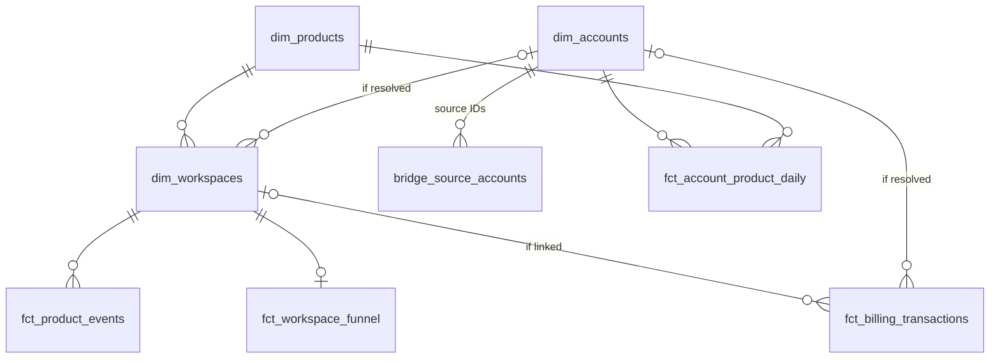

# multi-product-gtm-analytics

GTM analytics for a two-product SaaS business, using dbt and DuckDB to model customer journeys, unify accounts, and investigate conversion changes with tested synthetic data.

> **Case-study disclosure:** this is a fictional scenario using synthetic data. Products A and B are illustrative, and no result represents a real company.

See [PROJECT.md](PROJECT.md) for the business context, scope and metric contracts, and [docs/data-model.md](docs/data-model.md) for how the source tables connect.

## Status

| Area | State |
| --- | --- |
| Toolchain (Python 3.12, dbt Core 1.12.6, dbt-duckdb 1.11.1, DuckDB 2.0.0) | Pinned; see [docs/decisions/0001-toolchain-versions.md](docs/decisions/0001-toolchain-versions.md) |
| Source data model (relationship diagram, join keys) | Designed; see [docs/data-model.md §1](docs/data-model.md#1-source-relationship-diagram) |
| Seven raw source tables and two reference tables | Defined and tested |
| E01 counting-units fixture (3 companies, 4 paying account-products) | Loaded; verified against the expected ledger |
| Analytics data model (star schema, model catalog) | Designed; see [docs/data-model.md §2](docs/data-model.md#2-analytics-star-schema) |
| Staging, intermediate and mart models | Not started |
| Investigation and findings | Not started |

## Data model

Facts (center) connect to three dimensions: product, company and workspace. A bridge translates every CRM and billing ID into one canonical company. This is the target design; most facts are not built yet. See [docs/data-model.md](docs/data-model.md) for the full diagram, the source-table relationships and a catalog of every model.



## Run it

Requires [uv](https://docs.astral.sh/uv/). Run all commands from the repository root.

```sh
uv sync                                           # installs Python 3.12 deps from uv.lock
uv run python data_generation/load_fixtures.py    # builds raw.* and expected.* in gtm_analytics.duckdb
uv run dbt build --project-dir dbt_project --profiles-dir dbt_project
```

`dbt build` loads the reference seeds and runs every test. The fixture loader rebuilds the raw tables from scratch, so reruns are safe.

## Layout

| Path | Contents |
| --- | --- |
| `data_generation/raw_schema.sql` | Typed definitions of the seven raw tables |
| `data_generation/load_fixtures.py` | Loads a fixture's CSVs and expected ledger into DuckDB |
| `data_generation/fixtures/<fixture>/` | Hand-checkable source CSVs, `expected_*.csv` ledger and a README |
| `dbt_project/seeds/` | Reference tables: `ref_account_mapping`, `ref_event_mapping` |
| `dbt_project/models/staging/_sources.yml` | Source definitions, documentation and key tests |
| `dbt_project/tests/` | Singular tests (mapping intervals, fixture-vs-ledger counts) |
| `docs/data-model.md` | Source relationship diagram, join keys and modeling rules |
| `docs/decisions/` | Decision records |

## Database schemas

| Schema | Contents |
| --- | --- |
| `raw` | Source records exactly as delivered |
| `reference` | Seeded interpretation rules |
| `expected` | Independent expected-results ledger for the loaded fixture |

## Inspecting in DBeaver

Open `gtm_analytics.duckdb` with the DuckDB driver. Disconnect DBeaver before running the loader or dbt, because DuckDB allows only one writing process at a time. Timestamps are stored as UTC (`timestamptz`). Set the connection's time zone to UTC, or DBeaver will display them in local time.
