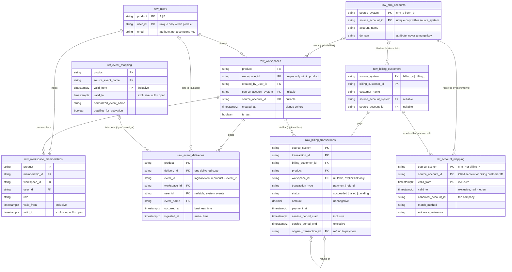

# Data Model

How the source data connects, and how the cleaned analytics tables are built from it.

- [1. Source relationship diagram](#1-source-relationship-diagram): the 7 raw tables and 2 reference tables
- [2. Analytics star schema](#2-analytics-star-schema): the cleaned dbt facts and dimensions *(not yet written)*

All data is synthetic. Table and column definitions live in [raw_schema.sql](../data_generation/raw_schema.sql) and [_sources.yml](../dbt_project/models/staging/_sources.yml).

---

## 1. Source relationship diagram

**How to read it:** `||` means exactly one, `|o` zero or one, and `o{` zero or many. Keys marked `PK` are composite: every ID is unique only within its product or source system.

### Join keys

| From | To | Join on | Cardinality |
| --- | --- | --- | --- |
| `raw_workspaces` | `raw_crm_accounts` | `source_account_system = source_system` and `source_account_id` | Many workspaces to 0..1 account. Null link means unresolved, never guessed |
| `raw_billing_customers` | `raw_crm_accounts` | `source_account_system = source_system` and `source_account_id` | Many billing customers to 0..1 account |
| `raw_workspaces` | `raw_users` | `product` and `created_by_user_id = user_id` | Many workspaces to one creator |
| `raw_workspace_memberships` | `raw_workspaces` | `product` and `workspace_id` | Many memberships to one workspace |
| `raw_workspace_memberships` | `raw_users` | `product` and `user_id` | Many memberships to one user |
| `raw_event_deliveries` | `raw_workspaces` | `product` and `workspace_id` | Many deliveries to one workspace |
| `raw_event_deliveries` | `raw_users` | `product` and `user_id` | Many deliveries to 0..1 user (null for system events) |
| `raw_event_deliveries` | `ref_event_mapping` | `product`, `event_name = source_event_name`, and `valid_from <= occurred_at < valid_to` | Each delivery to 0..1 mapping. Unmapped names stay visible |
| `raw_billing_transactions` | `raw_billing_customers` | `source_system` and `billing_customer_id` | Many transactions to one billing customer |
| `raw_billing_transactions` | `raw_workspaces` | `product` and `workspace_id` | Many transactions to 0..1 workspace. Unlinked payments are kept, not guessed |
| `raw_billing_transactions` (refund) | `raw_billing_transactions` (payment) | `source_system` and `original_transaction_id = transaction_id` | Many refunds to one payment |
| `raw_crm_accounts` | `ref_account_mapping` | `source_system` and `source_account_id`, with the validity interval at a stated `business_at` | One source record to many intervals, at most one valid at any moment |
| `raw_billing_customers` | `ref_account_mapping` | `source_system` and `billing_customer_id = source_account_id`, with the validity interval | Same as above |

### Many-to-many relationships

These relationships have no direct foreign key. Each one is resolved through another table:

| Relationship | Resolved through | Why it matters |
| --- | --- | --- |
| Users ↔ workspaces | `raw_workspace_memberships` | One person, such as a consultant, can belong to several companies' workspaces. A person never determines a company |
| Source records ↔ companies | `ref_account_mapping.canonical_account_id` | One company appears as several CRM accounts and billing customers across systems, such as Acme as crm_a/101, crm_b/987, cus_a_001 and cus_b_001 |
| Billing customers ↔ workspaces | `raw_billing_transactions` | One billing customer can pay for several workspaces, such as Acme's ws_100 and ws_101 |
| Event deliveries ↔ logical events | `(product, event_id)` | Retries create several delivery rows for one event. Dedupe is a staging step, not a raw deletion |

### Rules the diagram cannot show

- **Always join on the namespace too.** `crm_a/101` and `crm_b/101` are different companies, and `A/ws_100` and `B/ws_100` are different workspaces. A join on the ID alone silently merges them.
- **Interval joins need an explicit time.** Mapping joins use inclusive start and exclusive end. The consuming model must say which timestamp it uses: workspace `created_at` for signup ownership, `payment_at` for payments, an as-of time for current reporting, and `occurred_at` (not `ingested_at`) for event names.
- **No canonical company table exists in raw.** `canonical_account_id` appears only in `ref_account_mapping`. `dim_accounts` will be built from it in the analytics layer.
- **Aggregate before joining.** Joining events, memberships and transactions directly multiplies rows. Each is aggregated to the target grain first (see section 2).

---

## 2. Analytics star schema

*Not yet written.*
