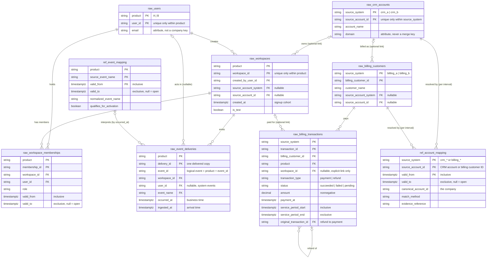
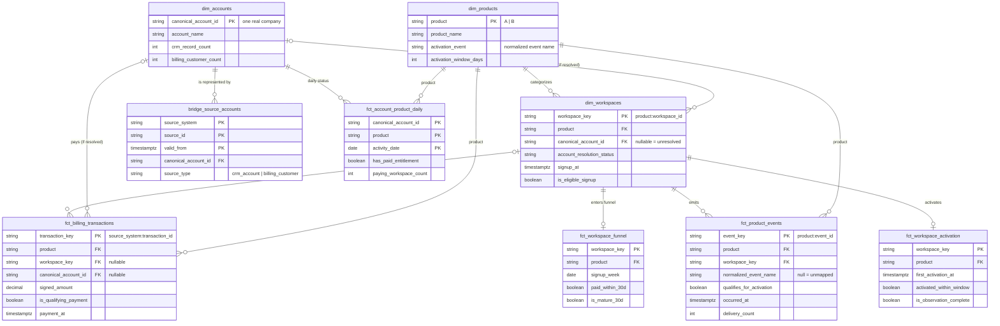

# Data Model

How the source data connects, and how the cleaned analytics tables are built from it.

- [1. Source relationship diagram](#1-source-relationship-diagram): the 7 raw tables and 2 reference tables
- [2. Analytics star schema](#2-analytics-star-schema): the cleaned dbt facts and dimensions (target design, built incrementally)

All data is synthetic. Table and column definitions live in [raw_schema.sql](../data_generation/raw_schema.sql) and [_sources.yml](../dbt_project/models/staging/_sources.yml).

---

## 1. Source relationship diagram

**How to read it:** `||` means exactly one, `|o` zero or one, and `o{` zero or many. Keys marked `PK` are composite: every ID is unique only within its product or source system.

### Join keys

| From | To | Join on | Cardinality |
| --- | --- | --- | --- |
| `raw_workspaces` | `raw_crm_accounts` | `source_account_system = source_system` and `source_account_id` | Many workspaces to 0..1 account. Null link means unresolved, never guessed |
| `raw_billing_customers` | `raw_crm_accounts` | `source_account_system = source_system` and `source_account_id` | Many billing customers to 0..1 account |
| `raw_workspaces` | `raw_users` | `product` and `created_by_user_id = user_id` | Many workspaces to one creator |
| `raw_workspace_memberships` | `raw_workspaces` | `product` and `workspace_id` | Many memberships to one workspace |
| `raw_workspace_memberships` | `raw_users` | `product` and `user_id` | Many memberships to one user |
| `raw_event_deliveries` | `raw_workspaces` | `product` and `workspace_id` | Many deliveries to one workspace |
| `raw_event_deliveries` | `raw_users` | `product` and `user_id` | Many deliveries to 0..1 user (null for system events) |
| `raw_event_deliveries` | `ref_event_mapping` | `product`, `event_name = source_event_name`, and `valid_from <= occurred_at < valid_to` | Each delivery to 0..1 mapping. Unmapped names stay visible |
| `raw_billing_transactions` | `raw_billing_customers` | `source_system` and `billing_customer_id` | Many transactions to one billing customer |
| `raw_billing_transactions` | `raw_workspaces` | `product` and `workspace_id` | Many transactions to 0..1 workspace. Unlinked payments are kept, not guessed |
| `raw_billing_transactions` (refund) | `raw_billing_transactions` (payment) | `source_system` and `original_transaction_id = transaction_id` | Many refunds to one payment |
| `raw_crm_accounts` | `ref_account_mapping` | `source_system` and `source_account_id`, with the validity interval at a stated `business_at` | One source record to many intervals, at most one valid at any moment |
| `raw_billing_customers` | `ref_account_mapping` | `source_system` and `billing_customer_id = source_account_id`, with the validity interval | Same as above |

### Many-to-many relationships

These relationships have no direct foreign key. Each one is resolved through another table:

| Relationship | Resolved through | Why it matters |
| --- | --- | --- |
| Users ↔ workspaces | `raw_workspace_memberships` | One person, such as a consultant, can belong to several companies' workspaces. A person never determines a company |
| Source records ↔ companies | `ref_account_mapping.canonical_account_id` | One company appears as several CRM accounts and billing customers across systems, such as Acme as crm_a/101, crm_b/987, cus_a_001 and cus_b_001 |
| Billing customers ↔ workspaces | `raw_billing_transactions` | One billing customer can pay for several workspaces, such as Acme's ws_100 and ws_101 |
| Event deliveries ↔ logical events | `(product, event_id)` | Retries create several delivery rows for one event. Dedupe is a staging step, not a raw deletion |

### Rules the diagram cannot show

- **Always join on the namespace too.** `crm_a/101` and `crm_b/101` are different companies, and `A/ws_100` and `B/ws_100` are different workspaces. A join on the ID alone silently merges them.
- **Interval joins need an explicit time.** Mapping joins use inclusive start and exclusive end. The consuming model must say which timestamp it uses: workspace `created_at` for signup ownership, `payment_at` for payments, an as-of time for current reporting, and `occurred_at` (not `ingested_at`) for event names.
- **No canonical company table exists in raw.** `canonical_account_id` appears only in `ref_account_mapping`. `dim_accounts` will be built from it in the analytics layer.
- **Aggregate before joining.** Joining events, memberships and transactions directly multiplies rows. Each is aggregated to the target grain first (see section 2).

---

## 2. Analytics star schema

This is the **target design**. Tables are built one PR at a time, and the Status column in the catalog below says which ones exist. A table marked *planned* is a design, not something you can query yet.

The reporting tables `mart_product_cohorts` and `mart_account_summary` are aggregates built on top of these facts. They are left out of the diagram for readability and are listed in the catalog.

### Model catalog

| Model | Type | Grain (one row is) | Primary key | Built from | Key information | Purpose | Status |
| --- | --- | --- | --- | --- | --- | --- | --- |
| `dim_products` | Dimension | One product | `product` | Static values defined in the model | Display name; normalized activation event; activation window (7 days) | One place for product-specific rules, so facts point to a product instead of repeating "A"/"B" logic | This branch |
| `dim_accounts` | Dimension | One canonical company | `canonical_account_id` | `bridge_source_accounts`, staged CRM accounts | Display name chosen by a documented rule; counts of CRM and billing records; first seen date. Parent company is a separate attribute later, never a merge | The company list. All company counts start here | This branch |
| `dim_workspaces` | Dimension | One workspace in one product | `workspace_key` (`product:workspace_id`) | Staged workspaces, `bridge_source_accounts` | Product; signup time and week; test and eligibility flags; resolved company (account mapping valid at signup); resolution status | Signup cohorts and the workspace-to-company link, with unresolved workspaces kept visible | This branch |
| `bridge_source_accounts` | Bridge | One source record mapped for one validity interval | `source_system`, `source_id`, `valid_from` | `ref_account_mapping`, staged CRM accounts and billing customers | Source type; company; match method; evidence; validity dates; whether the source record exists | Translates any CRM or billing ID into a company | This branch |
| `fct_product_events` | Fact (transaction) | One logical event, deduplicated across deliveries | `event_key` (`product:event_id`) | `stg_product_events` (deduped deliveries), `ref_event_mapping` | Source and normalized event name; activation flag; occurrence and first arrival times; delivery count | Product behavior, with retries removed and renamed events interpreted consistently | Planned |
| `fct_billing_transactions` | Fact (transaction) | One billing transaction | `transaction_key` (`source_system:transaction_id`) | Staged transactions, `bridge_source_accounts` | Type; status; amount and signed amount; currency; payment time; service period; refund link; company (mapping valid at payment time) | Paid outcomes and cash reconciliation, before any aggregation | Planned |
| `fct_workspace_activation` | Fact (accumulating snapshot) | One workspace | `workspace_key` | `dim_workspaces`, `fct_product_events`, `dim_products` | First qualifying event; activated within window; days to activation; whether the 7-day window has fully elapsed | Product-specific activation | Planned |
| `fct_workspace_funnel` | Fact (accumulating snapshot) | One eligible signup workspace | `workspace_key` | `dim_workspaces`, `fct_workspace_activation`, `fct_billing_transactions` | Signup week; activated; first linked payment; paid within 30 days; 30-day maturity; company-link flag | Signup-to-paid funnel using equal observation windows | Planned |
| `fct_account_product_daily` | Fact (periodic snapshot) | One company, product and date | `canonical_account_id`, `product`, `activity_date` | Billing, memberships and events, each aggregated to this grain first | Paid entitlement; paying workspaces; active members; net cash | Daily company-by-product status without join fan-out | Planned |
| `mart_product_cohorts` | Reporting mart | One product signup week | `product`, `signup_week` | `fct_workspace_funnel` | Numerator and denominator for each rate; maturity; identity coverage | Mature conversion comparison by product and cohort | Planned |
| `mart_account_summary` | Reporting mart | One company at a stated as-of time | `canonical_account_id`, `as_of` | `fct_account_product_daily`, `dim_accounts` | Paying products; multi-product flag; workspace counts by product | Reconciled paying-company and account-product counts | Planned |

### Design decisions

- **No "unknown company" row in `dim_accounts`.** Many star schemas add a placeholder row so that facts with no company still join. Here it would be counted as a paying company. Unresolved records keep a null `canonical_account_id` plus an `account_resolution_status`, and the coverage report lists them.
- **Each fact resolves the company at its own business time.** A workspace uses the mapping valid at signup. A payment uses the mapping valid at payment time. Reporting marts use the as-of time.
- **Composite source keys become single keys with the namespace inside them.** `workspace_key = 'A:ws_100'` cannot collide with `'B:ws_100'`, so downstream joins on one column stay safe.
- **Facts are aggregated to the target grain before they are joined.** `fct_account_product_daily` sums billing, memberships and events separately per company, product and date, then joins the results. Joining the detail tables first would multiply rows.
- **`dim_products` holds rules, not just labels.** It carries each product's activation event and window, so the activation logic is product-specific without being hard-coded in each fact.
